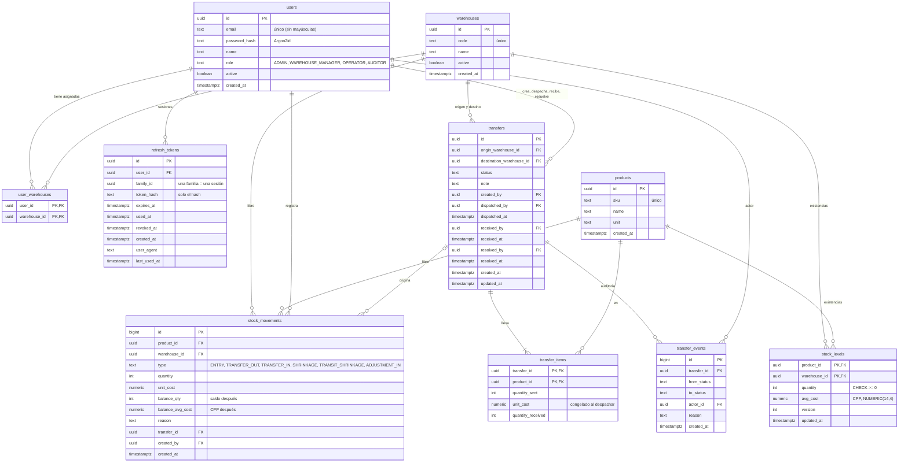
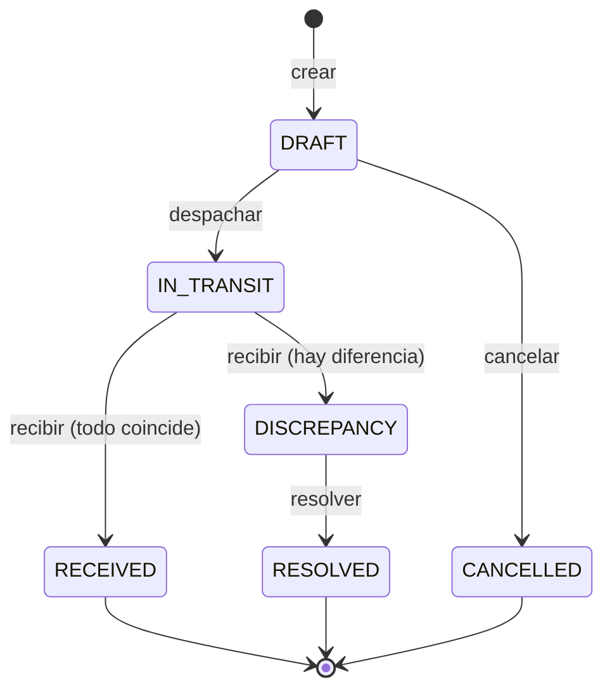

# logistica-backend

API del **Proyecto 21: logística y trazabilidad de stock multi-almacén**. Lleva el inventario de varias bodegas con un libro de movimientos inmutable, costeo por **Costo Promedio Ponderado (CPP)**, **traspasos entre bodegas con estados auditables** (en tránsito, con discrepancia, resuelto), control de **mermas**, reportes con exportación a CSV y PDF y avisos **en tiempo real** por WebSocket.

- Aplicación desplegada: https://logistica-backend-3c7w.onrender.com (el backend sirve también el frontend)
- Documentación interactiva de la API: `/api-docs` (Swagger)
- Frontend (Vue 3 + Pinia): [darkninghtt/logistica-frontend](https://github.com/darkninghtt/logistica-frontend)

Stack: Node.js 24 (LTS) · Express 5 · TypeScript estricto · PostgreSQL · Zod · pino · `ws` · Vitest + Supertest.

## Arquitectura

Capas por recurso, con las dependencias hacia abajo e inyectadas en un único punto de composición (`src/main.ts`):

```
routes → controller → service → repository → PostgreSQL
                         │
                       domain/   reglas puras: CPP, transiciones, permisos, errores
```

| Carpeta         | Qué hace                                                                                                                                                                        |
| --------------- | ------------------------------------------------------------------------------------------------------------------------------------------------------------------------------- |
| `routes/`       | Rutas de Express y su documentación Swagger (`@openapi`).                                                                                                                       |
| `controllers/`  | Solo HTTP: valida la entrada con Zod, llama al servicio y responde. Sin SQL ni reglas de negocio.                                                                               |
| `services/`     | Reglas de negocio, autorización (se repite aquí aunque el middleware ya la haya hecho) y transacciones. Sin `req`/`res` ni `pg`. Las interfaces de los repositorios viven aquí. |
| `repositories/` | Solo SQL parametrizado (`$1, $2`). Reciben el cliente de la transacción cuando corresponde.                                                                                     |
| `domain/`       | Funciones puras sin base de datos: CPP, máquina de estados de los traspasos, permisos y la jerarquía de errores.                                                                |
| `schemas/`      | Esquemas Zod de lo que entra y de lo que sale. Son también el contrato de la API (ver "Contrato de tipos").                                                                     |
| `middlewares/`  | Autenticación, rol, límites de peticiones, cabeceras de seguridad y el **único** manejador de errores.                                                                          |

Errores: los servicios lanzan errores de dominio tipados (`NotFoundError`, `ForbiddenError`, `ConflictError`, ...) y un solo middleware los traduce a `{ code, message, correlationId }`, sin detalles internos ni stack. Cada petición lleva `x-correlation-id` (se toma del header si es válido o se genera), que aparece en los logs de pino y en la respuesta.

## Modelo de datos

Migraciones versionadas con `node-pg-migrate` en `migrations/`. Nunca se edita una migración aplicada: se crea una nueva.



`stock_movements` y `transfer_events` son **inmutables**: un trigger rechaza cualquier `UPDATE` o `DELETE`. El libro de movimientos es la fuente de verdad y siempre cuadra con `stock_levels` (hay pruebas que lo verifican).

## Reglas del negocio

### Costo Promedio Ponderado

Por producto y bodega, y solo cuando **entra** stock (entrada, recepción de un traspaso o sobrante resuelto):

```
nuevo_costo = (cantidad × costo_actual + cantidad_entrante × costo_entrante) / (cantidad + cantidad_entrante)
```

Las salidas y las mermas se valoran al costo vigente y no lo cambian. Los costos se guardan como `NUMERIC(14,4)`, se calculan con `decimal.js` (nunca con `number`) y viajan en el JSON como texto. La fórmula vive en `src/domain/stock.ts` y tiene pruebas unitarias de los casos borde (destino sin stock, redondeo, entradas sucesivas, traspaso de ida y vuelta).

### Traspasos

Las transiciones válidas están definidas en un solo lugar (`TRANSITIONS` en `src/domain/transfer.ts`):



- **Despachar:** descuenta el stock del origen (`TRANSFER_OUT`) y **congela** el costo unitario de cada ítem (el CPP del origen en ese momento). La mercancía en tránsito no pertenece a ninguna bodega.
- **Recibir:** el destino declara lo que llegó de cada producto. Entra de inmediato `min(recibido, enviado)` al costo congelado (`TRANSFER_IN`, recalcula el CPP del destino). Si algo no coincide, el traspaso pasa a `DISCREPANCY` y la diferencia queda retenida, sin afectar el stock ni el CPP.
- **Resolver:** un faltante se registra como merma en tránsito (`TRANSIT_SHRINKAGE`) y un sobrante como ajuste de entrada (`ADJUSTMENT_IN`), los dos al costo congelado y con motivo. Quien recibió no puede resolver (separación de funciones). La diferencia no vuelve sola al origen: una devolución es un traspaso nuevo en sentido contrario.
- Cada cambio de estado queda en `transfer_events` (quién, cuándo, de qué estado a cuál y por qué).

### Mermas

`POST /api/stock/shrinkage` registra una merma de bodega (`SHRINKAGE`) con su motivo (`DAMAGE`, `EXPIRED`, `THEFT`, `COUNT_ADJUSTMENT`) y una nota opcional, valorizada al costo vigente. Si no alcanza el stock responde `409 INSUFFICIENT_STOCK`.

### Concurrencia e idempotencia

- Toda operación que toca stock corre en **una transacción** y bloquea las filas con `SELECT ... FOR UPDATE`, siempre **en el mismo orden** (bodega y producto) para evitar interbloqueos. Si aun así PostgreSQL detecta un deadlock o un fallo de serialización, la transacción se reintenta con espera creciente.
- Cada transición de un traspaso usa `UPDATE ... WHERE id = $1 AND status = $2` y comprueba `rowCount`: si otro ya lo cambió, responde `409` y no toca nada más. Por eso despachar o recibir dos veces (o en paralelo) **no se contabiliza dos veces**.
- `CHECK (quantity >= 0)` en la base de datos como última defensa, además de la validación del servicio.
- Las pruebas de concurrencia lanzan N peticiones en paralelo sobre el mismo stock y sobre el mismo traspaso y comprueban que no hay negativos, que nada se duplica y que el libro cuadra.

## Roles y permisos

La autorización se comprueba **en el backend**, por endpoint (rol en el middleware) y otra vez en el servicio (rol y bodega). El jefe de bodega y el operario solo operan sobre las bodegas que tienen asignadas.

| Acción                                   | ADMIN             | WAREHOUSE_MANAGER         | OPERATOR              | AUDITOR         |
| ---------------------------------------- | ----------------- | ------------------------- | --------------------- | --------------- |
| Gestionar usuarios, roles y asignaciones | Sí                | No                        | No                    | No              |
| Crear y editar bodegas y productos       | Sí                | No                        | No                    | No              |
| Registrar entrada de stock (con costo)   | Todas las bodegas | Bodega asignada           | No                    | No              |
| Ver stock y movimientos                  | Todas             | Solo asignadas            | Solo asignadas        | Todas (lectura) |
| Ver costos                               | Sí                | Sí                        | **No**                | Sí              |
| Crear traspaso (borrador)                | No                | Desde bodega asignada     | Desde bodega asignada | No              |
| Cancelar borrador                        | No                | Origen asignado           | Solo si lo creó       | No              |
| Despachar                                | No                | Origen asignado           | No                    | No              |
| Recibir                                  | No                | Destino asignado          | Destino asignado      | No              |
| Resolver discrepancia                    | Sí                | Origen o destino asignado | No                    | No              |
| Registrar merma                          | No                | Bodega asignada           | Bodega asignada       | No              |
| Kardex, reportes, dashboard y exportar   | Sí                | Solo asignadas            | No                    | Sí              |

Al OPERATOR la API no le envía ningún campo de costo. Una acción no permitida responde `403 FORBIDDEN`.

## Sesión y seguridad

- `POST /api/auth/login` devuelve `{ accessToken, user }`. El access token (JWT, 15 min) va en `Authorization: Bearer <token>`; el frontend lo guarda **solo en memoria**.
- El refresh token va en la cookie `refresh_token` (`HttpOnly`, `SameSite=Strict`, `Path=/api/auth`, `Secure` en producción). En la base solo se guarda su **hash**. `POST /api/auth/refresh` lo **rota**; reutilizar uno ya rotado revoca toda la familia (la sesión).
- **Sesiones activas:** `GET /api/auth/sessions` (las propias, marcando la actual), `DELETE /api/auth/sessions/:id`, `POST /api/auth/logout-all` y `PUT /api/auth/password` (cambiar la contraseña revoca las demás sesiones). Si el ADMIN cambia la contraseña de alguien o lo desactiva, se revocan todas sus sesiones.
- Contraseñas con **Argon2id**. Nunca se registran en los logs contraseñas, tokens ni cookies.
- **Límites de peticiones** por IP: 300 por minuto sobre `/api`, 10 intentos fallidos de login por 15 minutos y 60 refresh por 15 minutos (`429`). Se configuran con las variables `RATE_LIMIT_*`.
- `helmet` con **CSP** (`default-src 'self'`, sin `unsafe-inline` en los scripts); `/api-docs` tiene una CSP propia para Swagger UI.
- Todo lo que entra (body, query, params) y las variables de entorno se validan con Zod.

## Tiempo real (WebSocket)

El navegador no puede enviar `Authorization` al abrir un WebSocket, y el access token no debe ir en la URL. Por eso:

1. El cliente pide `POST /api/realtime/ticket` (autenticado) y recibe un **ticket aleatorio de un solo uso que vence en 30 s**.
2. Abre `wss://<mismo origen>/api/realtime?ticket=...`. El servidor valida y consume el ticket en el `upgrade`; sin ticket válido responde `401`. El ticket se oculta en los logs.
3. El servidor envía `{ type, payload }`:
   - `transfer.updated`: `{ transferId, status, originWarehouseId, destinationWarehouseId }`
   - `stock.changed`: `{ warehouseId, productIds }`

Los eventos no llevan costos: avisan qué cambió y el cliente vuelve a pedir el detalle por la API, que ya filtra por rol. Llegan al ADMIN y al AUDITOR siempre, y al jefe y al operario solo si alguna bodega del evento es suya. Se publican **después del COMMIT** a través de una cola en memoria con 3 intentos y espera creciente (si la transacción falla, no se emite nada). Ping/pong cada 30 s para cerrar conexiones muertas.

## Reportes

- `GET /api/stock/movements`: historial paginado **por cursor** (`limit`, `cursor`; responde `{ data, nextCursor }`).
- `GET /api/reports/kardex`: kardex valorizado por bodega y producto, en orden cronológico, con el saldo, el costo y el CPP resultante de cada movimiento.
- `GET /api/reports/shrinkage` (mermas de bodega y en tránsito), `GET /api/reports/in-transit` (mercancía en tránsito al costo congelado) y `GET /api/reports/summary` (dashboard).
- `.../export?format=csv|pdf` exporta el kardex y las mermas (CSV en UTF-8 con BOM para que Excel muestre bien las tildes; PDF con `pdfkit` por streaming).

## Contrato de tipos (Zod → OpenAPI)

Los esquemas Zod de `src/schemas/` (entradas y respuestas) son la fuente de verdad de la API. `src/swagger.ts` los convierte con `z.toJSONSchema` en los esquemas de Swagger, y `npm run openapi` escribe `openapi.json`, del que el frontend genera sus tipos con `openapi-typescript`.

- El CI falla si `openapi.json` no está al día con los esquemas (`npm run openapi:check`).
- La prueba de contrato (`tests/integration/contract.test.ts`) llama de verdad a cada endpoint y valida la respuesta con su esquema estricto; falla si un endpoint con respuesta JSON se queda sin probar.
- **Al cambiar la API:** ajustar el esquema Zod (y registrarlo en `API_SCHEMAS` si es nuevo), citarlo con `$ref` en la ruta, agregarlo a la prueba de contrato, correr `npm run openapi` y, después de fusionar, `npm run api:types` en el frontend.

## Correrlo en local

Requisitos: Node.js 24 (ver `.nvmrc`) y PostgreSQL (probado con la 18).

```bash
npm install
cp .env.example .env   # en PowerShell: Copy-Item .env.example .env
```

Una vez por máquina, crea el usuario y las bases de desarrollo y de pruebas con el superusuario de PostgreSQL:

```bash
psql -U postgres -h localhost -f scripts/setup-db.sql
```

Luego:

```bash
npm run migrate:up   # aplica las migraciones a la base de desarrollo
npm run seed:demo    # usuarios de cada rol y datos de demo (ver abajo)
npm run dev          # API en http://localhost:3000 (Swagger en /api-docs)
```

`GET http://localhost:3000/health` responde `{ "status": "ok" }`. Para la interfaz, levanta también el frontend (`npm run dev` en su repo): reenvía `/api` a este puerto.

### Usuarios y datos de demo

- `npm run seed` crea el ADMIN de `SEED_ADMIN_*` y, si sus variables están definidas, un jefe de bodega, un operario y un auditor (`SEED_MANAGER_*`, `SEED_OPERATOR_*`, `SEED_AUDITOR_*`), con las bodegas `BOD-A` y `BOD-B`. Es idempotente.
- `npm run seed:demo` hace lo mismo y además siembra datos realistas **a través de los servicios** (no con SQL suelto, para que el libro cuadre): tres bodegas, cinco productos, entradas con costos distintos, **un traspaso en cada estado** (borrador, en tránsito, recibido, con discrepancia pendiente, resuelto y cancelado) y mermas. Necesita el jefe de bodega. Si los datos de demo ya existen, no repite nada.
- Con `NODE_ENV=production` el seed rechaza las contraseñas de desarrollo de `.env.example`: en la nube se definen contraseñas propias en las variables de entorno.

El ADMIN gestiona los usuarios desde la pantalla de usuarios del frontend o por la API (`/api/users`).

## Pruebas

```bash
npm run migrate:test:up   # opcional: las pruebas aplican sus migraciones solas sobre TEST_DATABASE_URL
npm test
```

- **Unitarias** (`tests/unit/`): CPP, transiciones (todas las válidas y las inválidas), permisos, esquemas, servicios con dobles, la cola de tareas y la generación de archivos.
- **Integración** (`tests/integration/`, Vitest + Supertest) contra un PostgreSQL real de pruebas, partiendo de un estado limpio: endpoints, autorización (el caso permitido y el `403` de cada permiso), sesiones, WebSocket con un cliente real, concurrencia, contrato de la API y el seed de demo.
- El CI de GitHub Actions corre lint, typecheck, el chequeo del contrato y todas las pruebas contra un PostgreSQL de servicio en cada PR y en `main`.

## Despliegue (Render + Neon, un solo origen)

El backend sirve el build del frontend (`public/`) y la API bajo `/api`, todo desde la misma URL; así funciona la cookie `SameSite=Strict` del refresh y el WebSocket va al mismo origen. El `Dockerfile` de varias etapas clona el repo público del frontend (`FRONTEND_REPO`, `FRONTEND_REF`), lo compila, compila el backend y deja una sola imagen. Las rutas del router de Vue (por ejemplo `/stock`) devuelven `index.html`; `/api`, `/api-docs` y `/health` no se tocan.

**Variables de entorno en Render** (nunca en el repositorio):

| Variable       | Valor                                                                                     |
| -------------- | ----------------------------------------------------------------------------------------- |
| `NODE_ENV`     | `production`                                                                              |
| `DATABASE_URL` | Cadena de conexión de Neon (con `sslmode=require`)                                        |
| `JWT_SECRET`   | Secreto propio de producción, 32 caracteres o más (por ejemplo `openssl rand -base64 48`) |
| `TRUST_PROXY`  | `1` (Render pone un proxy delante)                                                        |
| `PORT`         | Lo define Render; no hace falta ponerlo                                                   |

**Pasos (la primera vez)**

1. En Neon, crear el proyecto y copiar la cadena de conexión.
2. **Migraciones (paso de despliegue, no al arrancar la app)**, desde tu PC contra Neon:
   ```powershell
   $env:DATABASE_URL = "<cadena de Neon>"; npm run migrate:up
   ```
3. Usuarios (y, si se quiere, datos de demo) en la base desplegada, con contraseñas de producción (mínimo 12 caracteres, distintas de las de desarrollo):
   ```powershell
   $env:NODE_ENV = "production"; $env:DATABASE_URL = "<cadena de Neon>"
   $env:SEED_ADMIN_EMAIL = "<correo>"; $env:SEED_ADMIN_PASSWORD = "<contraseña>"
   $env:SEED_MANAGER_EMAIL = "<correo>"; $env:SEED_MANAGER_PASSWORD = "<contraseña>"
   npm run seed:demo
   ```
4. En Render: New → Web Service → este repositorio → Runtime **Docker** → plan Free → variables de la tabla → deploy.
5. Comprobar `https://<servicio>.onrender.com/health`, la aplicación y `/api-docs`.

**Volver a desplegar:** cada push a `main` redespliega solo (o _Manual Deploy_ en Render). Si el frontend cambió y el backend no, usar _Manual Deploy → Clear build cache & deploy_ para que se vuelva a clonar. Si hay migraciones nuevas, correr el paso 2 **antes** de desplegar.

**Límites de los planes gratuitos** (verificados el 2026-10-20):

- Render (servicio web): se apaga tras 15 min sin tráfico y tarda ~1 min en volver; 750 horas de instancia al mes. Su Postgres gratuito expira a los 30 días, por eso la base está en Neon.
- Neon: 1 GB por proyecto y 100 CU-horas al mes; el cómputo se suspende tras 5 min sin uso (la primera consulta tarda un poco más).
- **Antes de una demo:** abrir `/health` unos 2 minutos antes y luego iniciar sesión una vez para despertar también la base.

## Scripts

| Script                                          | Qué hace                                           |
| ----------------------------------------------- | -------------------------------------------------- |
| `npm run dev`                                   | Arranca la API con recarga (lee `.env`)            |
| `npm run build` / `npm start`                   | Compila a `dist/` y ejecuta lo compilado           |
| `npm run migrate:up` / `migrate:down`           | Aplica o revierte migraciones (base de desarrollo) |
| `npm run migrate:test:up` / `migrate:test:down` | Lo mismo sobre la base de pruebas                  |
| `npm run seed` / `npm run seed:demo`            | Usuarios de cada rol / usuarios más datos de demo  |
| `npm run openapi` / `npm run openapi:check`     | Escribe `openapi.json` / falla si no está al día   |
| `npm run lint`                                  | ESLint y comprobación de formato con Prettier      |
| `npm run format`                                | Aplica Prettier                                    |
| `npm run typecheck`                             | `tsc --noEmit`                                     |
| `npm test`                                      | Pruebas unitarias y de integración con Vitest      |
